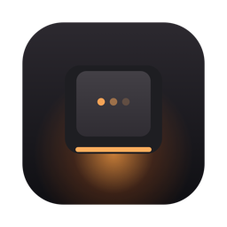
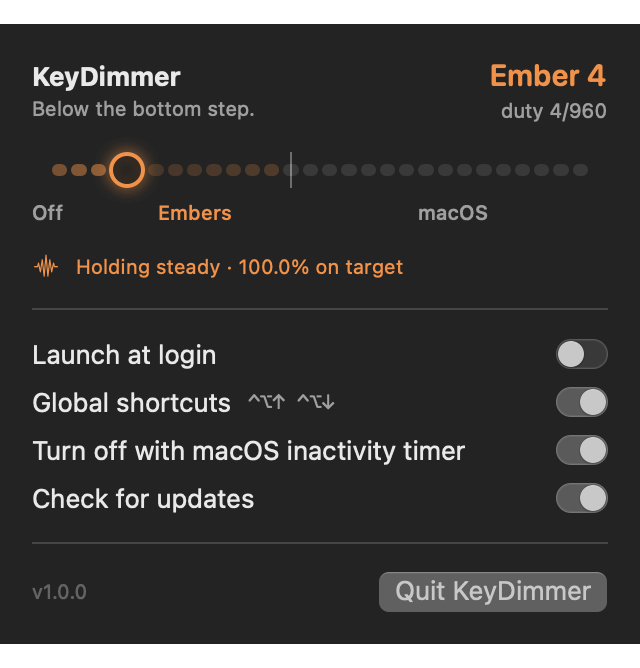

<p align="center"></p>

# KeyDimmer

**Below the bottom step.** A menu bar app that holds an Apple Silicon MacBook's keyboard backlight
*below* the dimmest level macOS allows — steadily, without the pulsing other tools accept.

<p align="center"></p>

## What it does

- **12 embers below the macOS minimum**, then all 16 macOS steps, on one slider (arrow keys step
  through it while the menu is open).
- **Calibrated to your Mac.** The floor macOS can reach differs between models (54/960 duty on a
  15" M4 MacBook Air). KeyDimmer measures it once and spreads the embers from 1 count up to ~80% of
  that floor, so there is no gap between the brightest ember and macOS's first step.
- **Steady hold.** The light is kept inside a single PWM count. Measured on hardware: 99.7–100%
  of 20 Hz samples exactly on target at duties of 1, 3, 12, 20 and 43 / 960.
- **Global shortcuts** ⌃⌥↑ / ⌃⌥↓ (no Accessibility permission needed).
- **Respects macOS.** Follows your "turn keyboard backlight off after inactivity" setting, goes dark
  on sleep and with the lid closed, steps aside the moment you change brightness in Control Center,
  and hands automatic brightness back exactly as it found it.
- **Leaves things tidy.** Quitting while on an ember leaves the keyboard at the dimmest level macOS
  can keep on its own.
- No accounts or analytics. The only network access is a daily check for new releases on GitHub,
  which you can turn off in the menu. ~0% CPU while holding.

Requires an Apple Silicon MacBook with a backlit keyboard and macOS 14 or later.

## Install

```sh
brew install --cask philzx/tap/keydimmer
```

Or download the latest `.dmg` from [Releases](https://github.com/philzx/keydimmer/releases/latest), open
it and drag KeyDimmer to Applications.

KeyDimmer isn't notarised by Apple, so macOS blocks it the first time you open it. Go to
**System Settings → Privacy & Security** and click **Open Anyway** — only needed once. Or, in
Terminal: `xattr -dr com.apple.quarantine /Applications/KeyDimmer.app`. (Homebrew installs skip this.)

KeyDimmer checks GitHub daily and offers updates in its menu; it installs them itself, or through
`brew upgrade` if Homebrew installed it.

## How it works

macOS clamps every non-zero keyboard brightness to a hardware floor, but a fade towards 0 passes
through every PWM duty below it. KeyDimmer uses CoreBrightness's private `KeyboardBrightnessClient`
to start fades and reads the actual duty (`high-period` of the `kbd-backlight` IOKit service).

Each fade is linear and takes a fixed time set by its speed (≈41 s at the slowest), whatever the
distance. The [hold engine](Sources/KeyDimmerCore/HoldEngine.swift):

1. **Approaches** the target with a quick fade, polling the duty every 4 ms, and syncs a model of
   the hidden fade position when the duty crosses a known count boundary.
2. **Holds** by alternating very slow fades down and up, reversing when the modelled position is
   0.2 counts either side of the centre of the target count — so the integer duty never changes.
3. **Resyncs** if a 1 Hz watchdog read disagrees with the model.

## Build

```sh
./scripts/build-app.sh          # → build/KeyDimmer.app (ad-hoc signed)
open build/KeyDimmer.app
```

`VERSION=1.2.0 ./scripts/package.sh` also builds `dist/KeyDimmer-1.2.0.dmg` and `.zip`. Pushing a
`v*` tag does the same on GitHub Actions and publishes a release.

Set `SIGN_IDENTITY="Developer ID Application: …"` to sign for distribution (notarise afterwards).

```sh
swift test                      # hold engine against a simulated backlight
swift run kdctl info            # backlight state
swift run kdctl hold 5 60       # hold duty 5/960 for 60 s and report stability
```

`KEYDIMMER_TRACE=1 build/KeyDimmer.app/Contents/MacOS/KeyDimmer` prints the engine's syncs and drifts.
`KeyDimmer --snapshot out.png ember:4` renders the menu (dark and light) without touching the backlight.

## Layout

| Path | |
| --- | --- |
| `Sources/KeyDimmerCore` | Hardware access, ladder, floor probe and hold engine (UI-free, tested) |
| `Sources/KeyDimmer` | SwiftUI menu bar app |
| `Sources/kdctl` | Diagnostics CLI |
| `Tests/KeyDimmerCoreTests` | Engine tests against a simulated panel |
